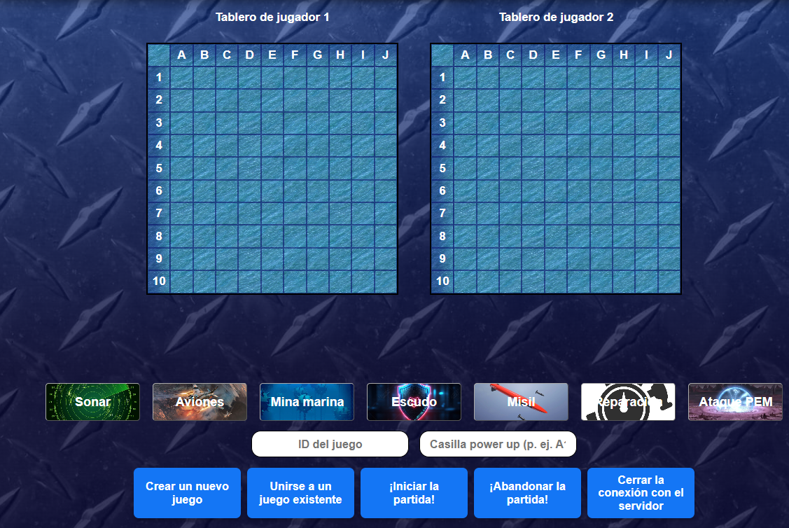
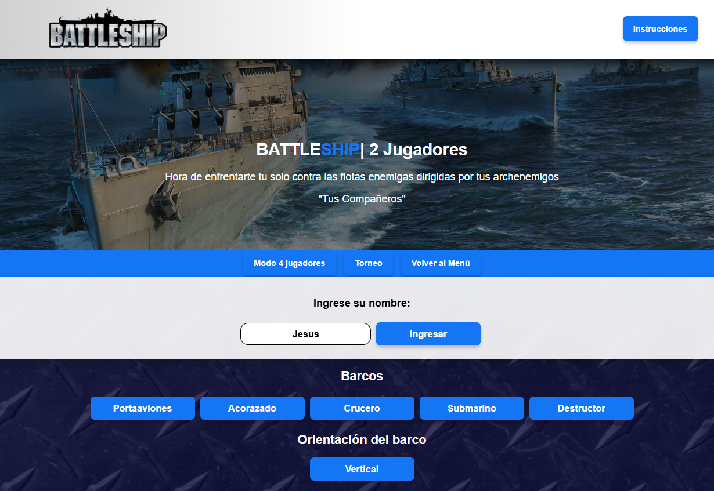

# ⚓ Batalla Naval: Real-Time Multiplayer (Deno & WebSockets)


Una reinterpretación moderna e interactiva del clásico juego de estrategia **Batalla Naval**. Desarrollado con una arquitectura cliente-servidor orientada a eventos, permitiendo partidas multijugador en tiempo real mediante **WebSockets** y el entorno de ejecución **Deno**.

## 📸 Vistas del Proyecto

<div align="center">
  
  
</div>

## ✨ Características Principales

- **Multijugador en Tiempo Real:** Comunicación bidireccional de baja latencia mediante WebSockets.
- **Batallas Épicas de hasta 4 Jugadores:** Soporte nativo para modos de 2 o 4 jugadores simultáneos.
- **Sistema de Torneos:** Crea salas, empareja jugadores, avanza de rondas dinámicamente y corónate campeón.
- **Power-Ups Estratégicos:** Habilidades especiales que pueden alterar el curso de la partida (ej. ataques en área).
- **Interfaz Reactiva (Vanilla JS):** Actualizaciones instantáneas del DOM basadas en los eventos del servidor sin necesidad de frameworks pesados.

## 🏗️ Arquitectura y Stack Tecnológico

- **Frontend:** HTML5, CSS3, Vanilla JavaScript (Manipulación de DOM y API WebSockets).
- **Backend:** Deno (TypeScript/JS), manejo concurrente de múltiples salas y estados de juego.
- **Red:** WebSockets para la sincronización de estados y eventos de la partida.

## 🚀 Instalación y Uso

### Prerrequisitos
- [Deno](https://deno.land/) instalado en tu máquina.
- [Visual Studio Code](https://code.visualstudio.com/) con la extensión **Live Server** o un servidor de archivos estáticos (ej. Python `http.server`).

### Ejecución Local
1. Clona este repositorio:
   ```bash
   git clone https://github.com/tu-usuario/Battleship-WEB.git
   ```
2. Inicia el servidor WebSocket con Deno:
   ```bash
   deno run --allow-net --watch server/server.ts
   ```
3. Ejecuta el cliente:
   - Abre la carpeta del proyecto en VS Code.
   - Haz clic derecho sobre `client/html/Battleship.html` (o la versión multijugador) y selecciona **Open with Live Server**.
   - Alternativamente, corre `python -m http.server 5500` en la raíz y entra a `http://localhost:5500/client/html/Battleship.html`.
4. ¡Abre varias pestañas para simular múltiples jugadores y probar la creación de salas!
